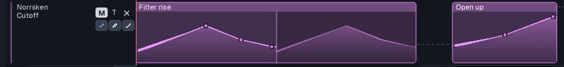

**Automation** makes a control move by itself as the song plays: a filter that opens over eight bars, a volume that swells into the chorus, a pan that drifts from side to side. You draw the movement as a curve, and Solmara turns the control as the playhead passes.

Automation lives in **lanes**, rows under a track. Each lane moves one control, and holds **automation clips**, which are clips of curves.

## Add a lane

Use any of these:

- **Turn the control.** Turn a knob, a fader or a slider, and a button at the top of the arrangement offers a lane for it, such as **+ Automate Filter: Cutoff**. Click it to add the lane.
- **Right-click the control** and choose to automate it in a lane.
- **Click A in the track's header.** It lists everything on that track that can be automated: the volume, the pan, and every knob of the track's devices. Pick one.

The lane appears under the track, named after its device and control. The triangle in the track's header folds the track's lanes away and shows them again.

## Make an automation clip

Automation clips are made the same way as any other clip:

1. Find an empty stretch of the lane.
2. **Double-click and hold**, then drag to the right to set how long the clip is.
3. Let go.

A double-click without dragging makes a clip as long as the last one you drew. Clips on a lane never overlap: a new clip stops where the next one starts.

Between clips, the control stays where its knob is set, shown by the dashed line.

## Draw the curve

You edit a clip's curve right where it lies on the lane. The curve is made of **points**, joined by lines:

| To | Do this |
| --- | --- |
| Add a point | Double-click the curve or an empty part of the clip |
| Remove a point | Double-click it |
| Move a point | Drag it. Hold <kbd>Cmd/Ctrl</kbd> to leave the grid |
| Bend a line between two points | Hold <kbd>Alt</kbd> (<kbd>Option</kbd>) and drag the line up or down |
| Draw freehand | Hold <kbd>Cmd/Ctrl</kbd> and drag |
| Draw a straight line | Hold <kbd>Shift</kbd> and drag |
| Select several points | Drag a box around them, or <kbd>Shift</kbd>-click them one by one |
| Delete the selected points | <kbd>Delete</kbd> (<kbd>Backspace</kbd> on a Mac) |

Right-click a point to choose how the curve goes on to the next point: a straight **line**, a **hold** that jumps at the next point, or a **bend**.

### The lane's tools

The lane's head has three small keys: **points**, **draw** and **line**. They choose what a plain drag does, so you can draw without holding a key. The keys in the table work whichever tool is chosen.

## Move, resize and loop automation clips

The strip with the clip's name works like any clip's: drag it to move the clip, and drag its edges to trim it. Drag the upper half of the right edge to make the clip longer or shorter, and the lower half to loop it.

A looped automation clip repeats its curve, like the **Filter rise** clip above: one sweep, played twice. You edit the first pass, and the repeats follow it. See [How clips loop](../../concepts/looping/).

## Make the lane taller

Drag the bottom edge of the lane's head down for more room to draw. Double-click that edge to bring the lane back to its usual height.

## Mute, record and delete a lane

- **M** mutes the lane: its clips go silent, and the control stays where its knob is set.
- **T** chooses how recording writes to the lane. With **touch**, it writes while you hold the control and lets go when you do. With **latch**, it keeps writing your last value until recording stops.
- **×** deletes the lane and its clips.

## Watch it play

While automation plays, the control it moves shows a red outline at the value automation has set. The knob itself stays where you set it, so you can see both at once.
