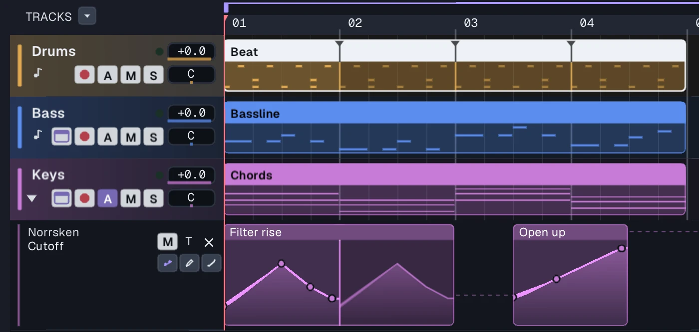
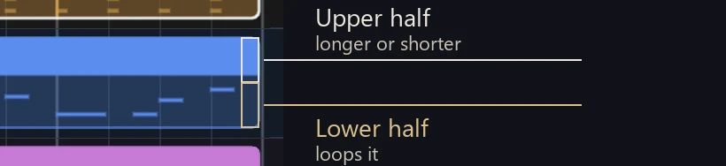

A song in Solmara is built from **clips**: pieces of music that lie on the tracks of the arrangement, one after another. A clip on a MIDI track holds notes; a clip on an audio track plays a recording. This page shows how to make clips and change them.

The **Beat** clip above is selected: its name strip is white. The small notches along its top mark where it starts over: it is a one-bar clip, looped four times.

:::tip
Everything on the arrangement has a right-click menu, and the menus name the shortcut for each action. When you are unsure how to do something, right-click it.
:::

## Make a clip

1. Find an empty place on a track's row.
2. **Double-click and hold**, then drag to the right. The clip follows the mouse, snapping to the grid.
3. Let go where the clip should end.

A double-click without dragging makes a clip as long as the last one you drew, or one grid cell long if you haven't drawn one yet. Hold <kbd>Cmd/Ctrl</kbd> while dragging to leave the grid.

The clip is the kind the track plays: a MIDI clip on a MIDI track. For other kinds, such as a drum pattern or a step pattern, right-click the empty place and choose **Create** and the kind.

## Select clips

- **Click** a clip to select it.
- **Shift-click** or **Cmd/Ctrl-click** adds a clip to the selection, or takes it out.
- **Drag a box** over empty space to select every clip it touches.
- <kbd>Cmd/Ctrl</kbd>+<kbd>A</kbd> selects everything.

Clicking the clip's name strip also sets the song to play from the clip's start. Clicking its body puts the playhead where you clicked.

## Move and copy clips

Drag a clip to move it, along its track or onto another track of the same kind. It snaps to the grid; hold <kbd>Cmd/Ctrl</kbd> while dragging to place it anywhere.

Hold <kbd>Alt</kbd> (<kbd>Option</kbd> on a Mac) while dragging to drop a copy and leave the original where it is. While you drag, a label at the pointer says what will happen when you let go.

When several clips are selected, dragging one moves them all.

## Make a clip longer or shorter

Point at a clip's **right edge**, in its **upper half**. The pointer becomes a pair of arrows. Drag left or right.

Making a clip shorter hides its end but doesn't delete it: drag the edge out again and it comes back.

The **left edge** trims the clip's start in the same way. What you trim away stays where it is in time, ready to be uncovered again.

## Loop a clip

Point at a MIDI or automation clip's right edge, in its **lower half**. A small loop badge appears beside the pointer. Drag to the right: the clip's content repeats for as long as you make it.

Each repeat after the first is drawn a shade darker, behind a notch in the clip's name strip. To change what repeats, edit the clip's first pass; the repeats follow.

To stop a clip looping, drag its edge from the **upper half** instead. You can also choose **Loop clip** or **Stop looping clip** in the clip's right-click menu, or switch **Loop** in the inspector, where you can also type the length of one pass.

[How clips loop](../../concepts/looping/) explains passes in more detail.

## Split, duplicate and delete

- **Split:** put the playhead inside a selected clip and press <kbd>Cmd/Ctrl</kbd>+<kbd>E</kbd>.
- **Duplicate:** <kbd>Cmd/Ctrl</kbd>+<kbd>D</kbd> puts a copy straight after the selected clips. Press it again for another.
- **Cut, copy and paste:** <kbd>Cmd/Ctrl</kbd>+<kbd>X</kbd>, <kbd>C</kbd> and <kbd>V</kbd>. A paste lands at the playhead, on the selected track.
- **Delete:** <kbd>Delete</kbd>, or <kbd>Backspace</kbd> on a Mac.

## Open a clip

**Double-click** a MIDI clip to open it in its own **Composer** window, where you write and edit its notes. Each clip has its own window, and you can have several open at once.

Pressing <kbd>Enter</kbd> on a selected clip opens its editor in the main area instead. <kbd>Esc</kbd> takes you back to the arrangement.

## Colour, rename and mute

Right-click a clip for **Rename**, **Mute**, **Colour** and **Tint**. A clip takes its track's colour unless you give it one of its own, and a tint lets you mark a part of the song, such as every chorus. A muted clip is greyed out with a line through its name, and stays silent.
